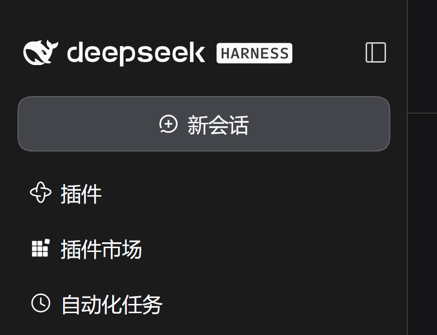
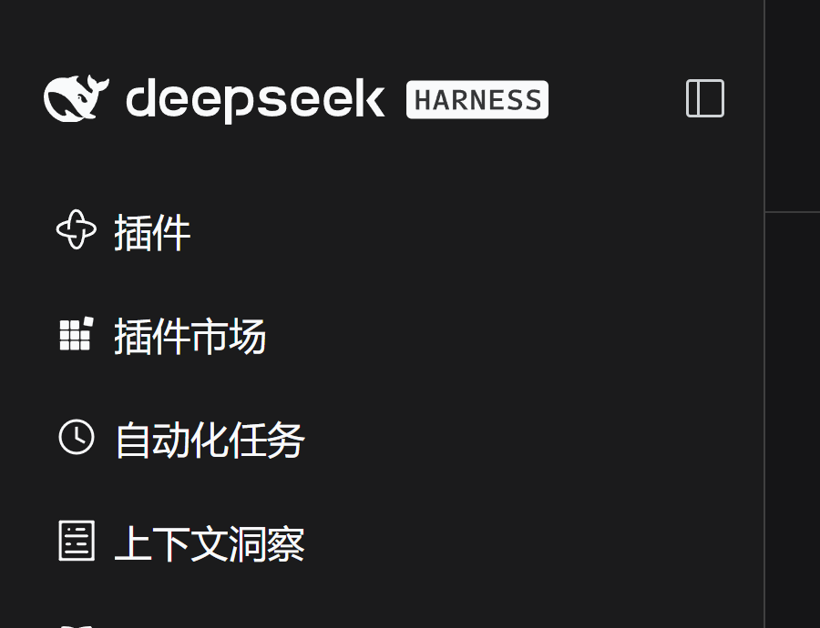

# dsh-hide-new-session

A [DeepSeek Harness](https://github.com/deepseek-ai/deepseek-harness) Web UI plugin that hides the full-width **New Session** button at the top of the left sidebar.

The button's box and its 10 px bottom margin are removed with it, so the plugin list below moves up and no empty gap is left behind. Everything else in the sidebar — brand, panel list, workspaces, footer — keeps its layout.

| Before | After |
|---|---|
|  |  |

## Why a style override

The button is hard-coded in the sidebar shell of `@deepseek-ai/dsh-client-ui-sidebar`:

```tsx
canStartSession && (
  <button className={styles.newSession} aria-label={t('session.new.label')} onClick={openNewSession}>
```

The package declares no slot for it, and the `sidebar` slot is a `single` slot that the sidebar shell already occupies, so a plugin cannot remove the control through the slot API. The browser plugin injects exactly one rule against the button's CSS-module class:

```css
button[class*="newSession"] { display: none !important; }
```

The `hHd-Xa_` hash prefix changes between builds, but the `newSession` local name is stable while the source keeps that class, so the selector matches on the suffix. The rule is injected when the client plugin is applied and removed when the plugin unloads, so disabling the bundle restores the button without a restart.

## What it does not change

- The brand row (logo) is still a New Session button in the wide sidebar.
- <kbd>Ctrl</kbd>+<kbd>Alt</kbd>+<kbd>N</kbd> still starts a new session.
- The macOS desktop leading New Session icon is untouched.

The plugin only hides the largest entry point, as requested; it never disables session creation itself.

## Install

Open **Plugins** in the sidebar, choose **Add plugin**, and enter the Git address:

```
https://github.com/hobin66/dsh-hide-new-session
```

Install it, then choose **Enable now**. The bundle is page-local hot-loaded: the button disappears without a reload.

From a terminal, the equivalent package install is:

```sh
dsh plugin --profile web add github:hobin66/dsh-hide-new-session
```

and the bundle `dsh-hide-new-session` then appears on the Plugins page to switch on.

## Compatibility

Tested with DeepSeek Harness `0.2.2-rc.1` (`@deepseek-ai/dsh-client-ui-sidebar` `0.2.2-rc.1`) in Chinese and English, in the expanded sidebar and the collapsed rail.

If a future release renames the `newSession` CSS-module class, the rule stops matching and the button simply comes back; update the selector in `client.js` to fix it. The plugin contains no other coupling to the DSH version.

## Uninstall

Switch the bundle off on the Plugins page, or remove it there. The injected `<style>` is disposed with the plugin.

## Package layout

| File | Role |
|---|---|
| `package.json` | Bundle manifest: `dsh.bundle.patch` and the `dsh.client` web declaration |
| `cordis.patch.yml` | Inserts the single `hide-new-session` row |
| `index.js` | Host half (no-op) that keeps the Loader row active |
| `client.js` | Browser half that injects and disposes the rule |
| `locale/en.json`, `locale/zh.json` | Plugin Manager titles and descriptions |
| `icon.svg` | Plugin Manager icon |

## 中文说明

这是一个 DeepSeek Harness Web 界面插件，用来隐藏左侧栏顶部那条整行的「新会话」按钮。

- 按钮是 `@deepseek-ai/dsh-client-ui-sidebar` 侧边栏外壳里写死的，没有对应 slot，所以插件通过注入一条 `button[class*="newSession"]{display:none}` 规则隐藏它；插件卸载时样式会一并移除。
- 只影响这块最大的按钮：品牌 logo 行、`Ctrl+Alt+N` 快捷键、macOS 桌面左上角的小图标都保持原样。
- 安装：侧边栏 **插件** → **添加插件** → GitHub 地址 `https://github.com/hobin66/dsh-hide-new-session` → 安装后点 **立即启用**。

## License

MIT
